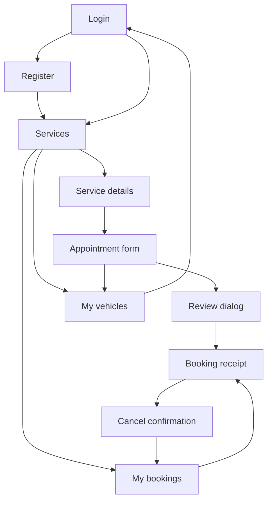
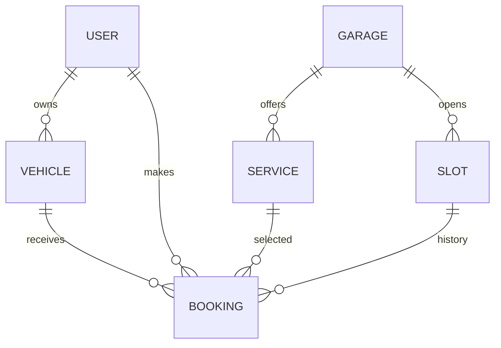

# UstaGo design and architecture

## Screen map

Services, Bookings and Vehicles are bottom tabs. Use Back from vehicle management to return to the appointment form. Form selections survive rotation, and receipts always read the database rather than depending on the previous screen's state.

## Room relationships

A slot can have several historical receipts following cancellation/rebooking, but only one active reservation. `slots.booked` is claimed conditionally inside a transaction and released only when its confirmed receipt is cancelled. All bookings must go through BookingDao; direct ad-hoc receipt insertion would bypass that business rule.

| Entity | Important typed fields |
|---|---|
| User | id: Long PK, fullName: String, email: String unique, passwordHash: String |
| Garage | id: Long PK, name/address/phone: String |
| CarService | id: Long PK, garageId: Long FK, name/category/description: String, price: Long |
| Vehicle | id: Long PK, userId: Long FK, model/plate: String, unique(userId, plate) |
| TimeSlot | id: Long PK, garageId: Long FK, startsAt: Long epoch milliseconds, booked: Boolean, unique(garageId, startsAt) |
| Booking | id/userId/serviceId/slotId/vehicleId: Long; snapshot text; startsAt/total/createdAt: Long; paymentMethod/paymentStatus/status/note: String |

## Architecture

Compose screens read state from UstaGoViewModel and send actions to it. The ViewModel calls UstaGoRepository for account/business rules, and the repository calls Room DAOs. Room Flow updates travel back to the UI through StateFlow. UstaGoApp owns the shared database/repository; MainActivity owns the Compose entry point.

## Visual choices

Teal communicates the primary action; warm orange is the secondary accent. Material 3 provides typography, cards, text fields, touch targets and theme colours. Service cards use text instead of external photos, so the whole catalogue remains available offline.

## Prototype boundaries

Garages, phone numbers and prices are fictional sample data. One shared bay per garage is a simple coursework scheduling model. The app does not notify a garage, verify actual business availability or synchronise across installations. A future backend must enforce appointment ownership and time capacity on the server, rather than trusting a client-side flag.
